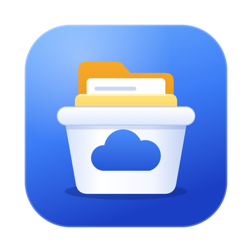

# GCS File Viewer



[](https://github.com/hcornelison/gcs-file-viewer/actions/workflows/ci.yml)
[](https://github.com/hcornelison/gcs-file-viewer/actions/workflows/ci.yml)
[](LICENSE)

A desktop file browser for Google Cloud Storage, in the style of Windows Explorer or GNOME Files. Pick a Google Cloud project and choose one of its buckets, or open any bucket by name, then browse the objects as folders and files. You can preview files, search, download and upload whole folders, copy, move, rename, delete and create folders.

Built with .NET 10 and [Avalonia](https://avaloniaui.net/), so it runs on macOS, Windows and Linux.

This is an independent open-source project. It is not affiliated with, endorsed by or supported by Google. Google Cloud and Google Cloud Storage are trademarks of Google LLC.

## Prerequisites

- [.NET 10 SDK](https://dotnet.microsoft.com/download/dotnet/10.0)
- Google credentials with access to the buckets you want to browse (see below). Public buckets need none.

On macOS with Homebrew:

```bash
brew install --cask dotnet-sdk
brew install --cask gcloud-cli
```

## Authentication

The app uses the first of these that it finds:

1. **A service account key file** you choose with the **Use key file…** button in the project prompt.
2. **Application Default Credentials**, from `gcloud auth application-default login` or the `GOOGLE_APPLICATION_CREDENTIALS` environment variable.
3. **Your gcloud CLI login**, from `gcloud auth login`. The app runs `gcloud auth print-access-token` and refreshes the token every 45 minutes. `gcloud` must be on your `PATH` or in a standard install location.

For most people the only setup needed is:

```bash
gcloud auth login
```

The project prompt shows which of the three is in use.

Public buckets opened by name work with no credentials at all: if the signed-in account can't list a bucket, or nobody is signed in, the app falls back to anonymous access.

Your account needs these permissions:

| Permission | Used for |
|---|---|
| `storage.buckets.list` | Listing the project's buckets |
| `storage.objects.list` | Browsing a bucket |
| `storage.objects.get` | Downloading, previewing and viewing details |
| `storage.objects.update` | Editing content type and Cache-Control |
| `storage.objects.create` | Uploading files, creating folders, copying, moving, renaming |
| `storage.objects.delete` | Deleting, moving, renaming, and replacing an existing file |
| `resourcemanager.projects.list` | Optional: autocomplete in the project prompt |

## Run

From the repository root:

```bash
dotnet run --project src/GcsFileViewer
```

## Using the app

1. Enter a project ID in the prompt, or pick one from the autocomplete list, and click **Connect**. The box is pre-filled from `GOOGLE_CLOUD_PROJECT` or your gcloud default project when one is set.
2. The project's buckets appear in the sidebar and in the main list. Double-click one to open it.
3. Double-click folders to go deeper. Use the toolbar buttons or the breadcrumb bar to move around, and the filter box to narrow the current folder by name.
4. Right-click for **Download…** or **Copy gs:// URI**. Double-clicking a file also downloads it. One file gets a save dialog; several items, or any folder, are written under a folder you choose, with folders keeping their structure.

**Open project or bucket…** in the sidebar reopens the prompt.

### Light and dark mode

The app starts in light mode. Click **Dark** in the toolbar to switch to the dark theme, and again to switch back. The choice is remembered for next time in a `settings.json` file in your application data folder (`~/Library/Application Support/GcsFileViewer` on macOS, `%APPDATA%\GcsFileViewer` on Windows, `~/.config/GcsFileViewer` on Linux).

### Large folders

A folder is loaded a page at a time (up to 1,000 items per page), so even a folder with millions of objects opens straight away. The status bar shows a count such as `1,000+ items · more to load`; the next page loads as you scroll to the bottom, or when you click **Load more**. Sorting and the filter box work on what has been loaded so far. Checking whether a name is taken, before an upload, rename, paste or new folder, asks about that name directly and doesn't load the rest; only when more than 25 names need checking at once does the app load the whole folder instead.

### Searching

The filter box narrows the folder you are looking at as you type. Press `Enter` in it to search every folder underneath instead. Results list each match with the folder it is in; right-click one and choose **Open containing folder** to go there. Press Up or Back to return.

- The search looks for your text anywhere in the object's path, so it also finds everything inside folders whose names match.
- It is case-sensitive, because Cloud Storage's own matching is.
- Text with wildcards is used as a pattern relative to the current folder: `*.csv` matches CSV files directly in it, `**.csv` matches them at any depth, and `?` matches one character.

### Details and preview

Click **Details** in the toolbar to open a pane on the right for the selected item.

- **Properties**: location, size, content type, storage class, created and modified times, generation, checksums, and any custom metadata.
- **Edit**: change a file's content type or `Cache-Control` header and click **Save**.
- **Preview**: text files show their first 64 KB; PNG, JPEG, GIF, BMP and WebP images up to 10 MB are shown in full.

While the pane is open, a file that stays selected for a quarter of a second makes two small requests (its metadata and its preview), so moving quickly through a list doesn't fetch every file you pass. Nothing is fetched while the pane is closed. Files in Nearline, Coldline or Archive storage are never read for preview, to avoid retrieval fees.

### Folder sizes

Right-click a folder or bucket and choose **Calculate size**. The app lists everything inside it, shows a running count, and puts the total in the Size column. This takes one request per 1,000 objects, so it is cheap but can take a while on very large folders; it can be cancelled.

### Progress and cancelling

Downloads, uploads, deletes, copies, moves, renames and size calculations show progress in the status bar, with a **Cancel** button. Only one runs at a time.

Cancelling stops before the next object; it doesn't undo what has already happened. A cancelled download can leave a partly written file, and a cancelled folder move can leave some objects copied but not yet removed from the original. The folder is refreshed afterwards so you can see where things stand.

### Opening a bucket by name

In the prompt, type a bucket name, a `bucket/folder` path or a `gs://` URI under **Or open a bucket by name** and click **Open**. No project is needed. This is the way to browse public buckets (for example `gcp-public-data-landsat`) and buckets in projects whose bucket list you can't see. The bucket is added to the sidebar for the rest of the session.

A public bucket only opens if it allows listing its objects. Some allow downloading individual objects but not listing, and those can't be browsed.

### Uploading

Inside a bucket, click **Upload…** in the toolbar, choose **Upload files here…** or **Upload folders here…** from the right-click menu, or drop files and folders from your file manager onto the list. They go into the folder you are viewing, and folders keep their structure. If a file with the same name is already there, or a folder you are uploading would merge into an existing one, the app asks first. Empty folders are not uploaded.

### New folders and renaming

Inside a bucket, click **New folder** in the toolbar (or **New folder…** in the right-click menu) and type a name. To rename a file or folder, select it and press `F2`, or right-click and choose **Rename…**. A name that is already used in the same folder is refused.

Cloud Storage has no real folders or rename operation, so:

- A new folder is an empty placeholder object whose name ends in `/`.
- Renaming copies the object to the new name and then deletes the original. Renaming a folder does this for every object inside it, which can take a while for large folders. All copies are made before any original is deleted.

### Copying and moving

Select files or folders and press `Ctrl+C` to copy or `Ctrl+X` to cut (`Cmd+C` / `Cmd+X` on macOS), or use **Copy** and **Cut** in the right-click menu. Open the destination folder, which can be in a different bucket, and press `Ctrl+V` / `Cmd+V` or choose **Paste**.

- Pasting a copy into the folder it came from names it `name (copy)`.
- If the destination already has an item with the same name, the app asks first; files are replaced and folders are merged.
- A folder can't be copied or moved into itself.
- A move is a copy followed by deleting the originals, with all copies made first. Large folders take a while.

The app's clipboard is separate from the system clipboard, so it doesn't interact with your file manager.

You can also drag items instead: drag selected files or folders onto a folder in the list, a bucket in the sidebar, or a folder in the breadcrumb bar to move them there. The place they would land is highlighted as you drag over it. Hold `Ctrl` (or `Option` on macOS) while dropping to copy instead.

### Deleting

Select files or folders and press `Delete` (`Cmd+Backspace` on macOS), or right-click and choose **Delete…**. The app asks for confirmation first. Deleting a folder deletes every object inside it. Buckets themselves can't be deleted from the app.

### Cost estimate

The right end of the status bar shows an estimate of what the session has cost in Cloud Storage charges, for example `Est. cost: <$0.01`. Click it for a breakdown: list, upload and copy requests; download and read requests; deletes (free); data downloaded; and data retrieved from Nearline, Coldline or Archive storage. **Reset** starts the tally again.

It is an estimate, not a bill:

- It uses Google's list prices for single-region buckets, recorded in `GcsPricing.cs` with the date they were taken from the [pricing page](https://cloud.google.com/storage/pricing). Requests in buckets from a listed project are priced by that bucket's storage class and doubled for multi-region buckets; buckets opened by name are priced as Standard, single-region.
- Buckets with hierarchical namespace enabled cost about 30% more per request than the estimate assumes.
- It covers only what this app did since it started. Storage itself, the free tier, discounts and other tools' usage are not included.
- Early deletion fees are not priced. If you delete, move, rename or replace objects in Nearline, Coldline or Archive storage, the breakdown says how many, and the app warns before you do it.
- Public buckets opened without signing in are billed to their owner and aren't counted.

Your actual charges are in Cloud Billing, usually within a day.

Browsing is close to free: one request per page of up to 1,000 objects. Search and **Calculate size** cost the same per page of results scanned. What costs real money is downloading large files, and folder-level copy, move, rename and delete, which make a request or two per object inside the folder.

| Shortcut | Action |
|---|---|
| `Alt+Left` / `Alt+Right` | Back / forward |
| `Alt+Up` or `Backspace` | Up one level |
| `F5` or `Cmd+R` | Refresh |
| `Enter` | Open the selected item |
| `Ctrl+C` / `Ctrl+X` / `Ctrl+V` (`Cmd` on macOS) | Copy / cut / paste |
| `F2` | Rename the selected item |
| `Delete` or `Cmd+Backspace` | Delete the selected items |

## Test

```bash
dotnet test
```

The tests use xUnit v3 on Microsoft.Testing.Platform, which `global.json` selects for `dotnet test`. The test project is also a program in its own right, so `dotnet run --project tests/GcsFileViewer.Tests` runs them too.

Most tests run against an in-memory fake of Cloud Storage, so they need no credentials or network access.

A few run the real client library against a Cloud Storage emulator, to check the fake hasn't drifted from how the API behaves. They are skipped unless `STORAGE_EMULATOR_HOST` is set. To run them locally:

```bash
docker run -d -p 4443:4443 fsouza/fake-gcs-server:1.56.1 -scheme http -public-host localhost:4443
STORAGE_EMULATOR_HOST=http://localhost:4443/storage/v1/ dotnet test
```

On GitHub, every push and pull request runs them too. Open a run from the [Actions tab](https://github.com/hcornelison/gcs-file-viewer/actions/workflows/ci.yml) to see the summary: pass, fail and skip counts with every test listed. Failures also appear as annotations on the run and on the changed lines of a pull request. Below the test results is a code coverage table with line and branch coverage per class, and the full line-by-line HTML report is attached to the run as the `coverage-report` artifact.

To produce the coverage report locally:

```bash
dotnet tool restore
dotnet test --coverlet --coverlet-output-format cobertura --coverlet-exclude-by-attribute GeneratedCodeAttribute --results-directory TestResults
dotnet reportgenerator "-reports:TestResults/**/coverage.cobertura*.xml" -targetdir:coverage "-reporttypes:Html"
```

Then open `coverage/index.html`.

## Packages and releases

Pushing a tag like `v1.2.3` runs `.github/workflows/release.yml`, which builds these packages and publishes them on the [Releases](https://github.com/hcornelison/gcs-file-viewer/releases) page. Each one bundles the .NET runtime, so nothing else needs installing besides the gcloud CLI if you sign in with it.

| Platform | File | Install |
|---|---|---|
| Windows (x64, Arm64) | `GcsFileViewer-<version>-win-<arch>.zip` | Unzip and run `GcsFileViewer.exe`. |
| macOS (Apple silicon, Intel) | `GcsFileViewer-<version>-osx-<arch>.zip` | Unzip and move `GCS File Viewer.app` to Applications. |
| Debian and Ubuntu (x64, Arm64) | `gcs-file-viewer_<version>_<arch>.deb` | `sudo apt install ./gcs-file-viewer_<version>_<arch>.deb`, then start it from the app menu or run `gcs-file-viewer`. |
| Other Linux (x64, Arm64) | `GcsFileViewer-<version>-linux-<arch>.tar.gz` | Extract and run `gcs-file-viewer/GcsFileViewer`. |

```bash
git tag v1.2.3
git push origin v1.2.3
```

Running the workflow by hand from the Actions tab builds the same packages as workflow artifacts without publishing a release, which is the way to try a packaging change.

Every package contains the project's `LICENSE` and a `THIRD-PARTY-NOTICES.txt` listing the libraries bundled inside it with their licences. `scripts/make-notices.py` writes that file during packaging from what was actually published, so it cannot fall out of date.

### First launch warnings

The packages are not signed with a paid code signing certificate, so Windows and macOS warn about them once:

- **Windows** shows "Windows protected your PC". Choose **More info**, then **Run anyway**.
- **macOS** says the app can't be opened. Open **System Settings > Privacy & Security**, scroll to the message about GCS File Viewer and choose **Open Anyway**.

### Verifying a download

Each release includes a `SHA256SUMS` file. While the repository is public, the release also carries a signed [build provenance attestation](https://docs.github.com/en/actions/security-for-github-actions/using-artifact-attestations) for every file, which proves the file was built by this repository's release workflow from the tagged commit. Check one with the [GitHub CLI](https://cli.github.com):

```bash
gh attestation verify GcsFileViewer-1.2.3-osx-arm64.zip --repo hcornelison/gcs-file-viewer
```

GitHub does not offer attestations to private repositories, so the workflow skips that step until the repository is public.

### Building a package locally

```bash
scripts/package-macos.sh osx-arm64 1.2.3 dist
```

```bash
scripts/package-linux.sh linux-x64 1.2.3 dist
```

The macOS script needs macOS. The Linux script builds the `.tar.gz` anywhere and the `.deb` where `dpkg-deb` is installed.

## Project layout

| Path | Contents |
|---|---|
| `src/GcsFileViewer.Pricing` | Cloud Storage list prices and a usage tally that turns requests into an estimated cost. No dependencies. |
| `src/GcsFileViewer.GcloudAuth` | Uses the gcloud CLI's own login as a Google credential that refreshes itself. |
| `src/GcsFileViewer.Storage` | Everything that talks to Cloud Storage: listing, search, transfers, metadata. No UI dependency. |
| `src/GcsFileViewer.Core` | The view models: browsing, operations, dialogs, details pane, cost estimate. |
| `src/GcsFileViewer` | The Avalonia app: window, icons and startup. |
| `tests/GcsFileViewer.Tests` | xUnit v3 tests for all of the above. |

Each library depends only on the ones above it in the table, so the storage layer can be reused without the UI, and the pricing and gcloud libraries without either.

`scripts/` holds the packaging scripts, and `packaging/licenses` the standard licence texts they put in the notices file.

The app icon is drawn in `src/GcsFileViewer/Assets/icon.svg`. After changing it, run `scripts/make-icon.sh` (macOS only) to rebuild the `.png`, `.ico` and `.icns` files beside it.

`GcsFileViewer.slnx` ties the projects together. `Directory.Build.props` sets the target framework and turns warnings into errors, `Directory.Packages.props` holds every package version in one place, and `.editorconfig` holds the code style the build enforces.

## VS Code

Open the repository folder with the [C# Dev Kit](https://marketplace.visualstudio.com/items?itemName=ms-dotnettools.csdevkit) extension installed. `F5` builds and launches the app, the default build and test tasks run `dotnet build` and `dotnet test`, and the tests appear in the Test Explorer. The repository's `.vscode/settings.json` turns on the Test Explorer's support for the test platform the tests use.

## Contributing

Bug reports, ideas and pull requests are welcome; see [CONTRIBUTING.md](CONTRIBUTING.md) and the [code of conduct](CODE_OF_CONDUCT.md). Report security problems privately as described in [SECURITY.md](SECURITY.md). Changes are recorded in [CHANGELOG.md](CHANGELOG.md).

## License

Released under the [MIT License](LICENSE). You can use, change and redistribute it, including commercially, as long as the copyright notice stays with it. The libraries it is built on have their own permissive licences, listed in the `THIRD-PARTY-NOTICES.txt` inside each package.

It builds on these open-source packages, each under its own permissive license: Avalonia, CommunityToolkit.Mvvm and MimeMapping (MIT), and Google's Cloud Storage and Resource Manager client libraries (Apache 2.0).
